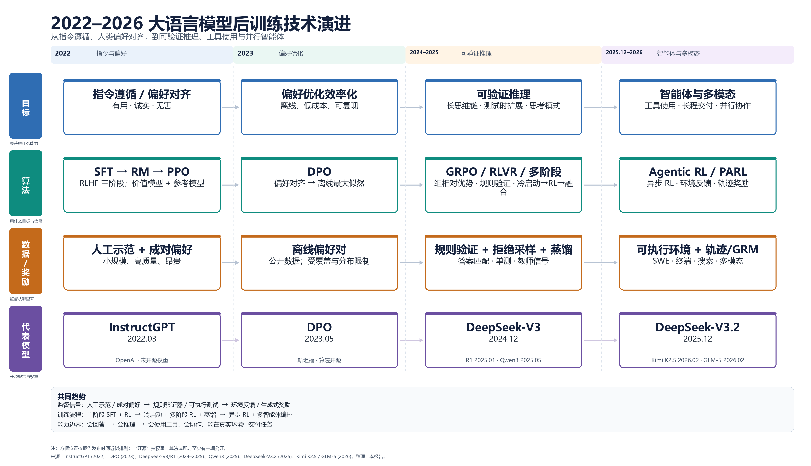
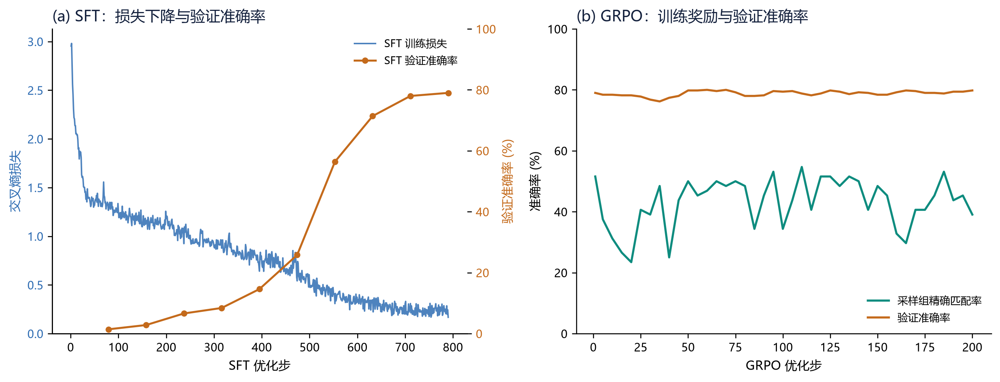
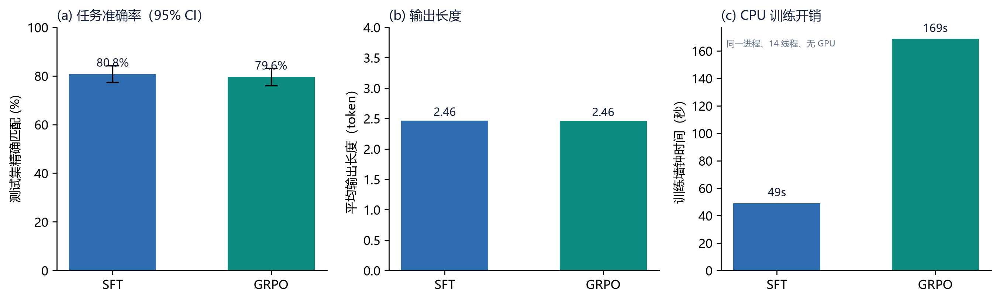
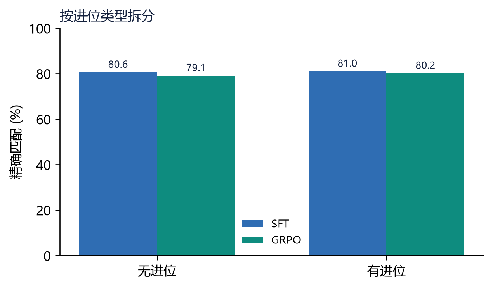

# 从 InstructGPT 到推理模型与智能体

## 大语言模型后训练技术综述与 SFT/GRPO 实证（2022—2026）

> **合并报告**：技术综述 + 算法代码细节 + 可验证任务实验  
> 版本：2026-11-10  
> 代码与数据：[`experiment/`](experiment/)　综述单行本：[`survey/`](survey/)

---

## 摘要

后训练已从“让模型听懂指令、符合偏好”的单一对齐阶段，演变为由监督微调、偏好优化、可验证奖励强化学习、多阶段课程与智能体环境交互共同构成的系统工程。本文第一部分以 InstructGPT、DeepSeek-V3、DeepSeek-R1、Qwen3、DeepSeek-V3.2、Kimi K2.5 与 GLM-5 的技术报告为主线，辅以 DPO 与 GRPO 的方法论文，梳理 2022—2026 年后训练目标、算法、数据与奖励机制的演进。第二部分把这套框架落到一个可验证的两位整数加法任务上：用 0.6M 参数字符级 Transformer 比较 SFT 与 GRPO，记录训练损失、任务准确率、输出长度与计算开销。

综述部分的核心判断是：奖励信号正从人工示范与成对偏好，转向规则验证器、可执行环境和生成式奖励；优化对象正从单轮回答转向长程轨迹；训练流程正从单阶段 SFT+RL 转向“冷启动—推理 RL—模式融合—通用/智能体 RL—蒸馏”的多阶段课程；竞争焦点也从算法本身转向环境、奖励与异步 RL 基础设施。实验部分则给出一个审慎的负结果：SFT 达到 **80.8%** 测试精确匹配，GRPO 为 **79.6%**（McNemar `p=0.114`），输出长度几乎不变，但 GRPO 的训练墙钟时间为 SFT 的 **3.44 倍**。这说明 GRPO 的收益是有条件的，而不是“替换 SFT 即涨点”。

**关键词**：后训练；RLHF；DPO；GRPO；RLVR；智能体；可验证奖励；负结果

---

## 核心结论

1. **目标迁移**：2022 年指令遵循/偏好对齐 → 2023—2024 年偏好优化效率化 → 2024—2025 年可验证推理 → 2025—2026 年智能体、多模态与并行协作。
2. **算法谱系**：SFT → PPO/RLHF → DPO → GRPO/RLVR → 多阶段 RL → Agentic RL/PARL；算法越来越依赖“数据—奖励—环境—系统”的协同，而不是单一损失函数。
3. **数据与奖励**：人工示范/成对偏好 → 模型生成与拒绝采样 → 规则验证器/可执行测试 → 环境反馈/轨迹奖励/GRM。结果奖励稀疏但抗攻击；过程奖励密集却难定义、易被 reward hacking；轨迹奖励最贴近部署，但信用分配最难。
4. **实证结果**：在本实验的 0.6M 模型、5,000 题、短答案、二值奖励设置下，GRPO 没有带来可测的准确率收益，却把训练开销提高到 3.44 倍。
5. **工程启示**：采用 GRPO 前，应先确认 SFT 是否接近任务上限、奖励是否足够密、模型是否有容量和推理空间利用探索信号；否则增加的可能只是计算，而不是能力。

---

# 第一部分　技术综述

## 1. 后训练目标的四次迁移

### 1.1 2022：指令遵循与偏好对齐

InstructGPT 用“人工示范 → 奖励模型 → PPO”的三阶段流程，把通用 GPT-3 变成更会听话的助手：1.3B 的 InstructGPT 输出在人类评估中优于 175B GPT-3；175B 版本相对 GPT-3 的胜率为 85%±3%，相对 few-shot GPT-3 为 71%±4%[1]。它用约 13k 条示范训练 SFT、33k 条成对比较训练 6B 奖励模型、31k 条无标签 prompt 做 PPO；为缓解对齐税，PPO-ptx 还把预训练梯度混入 RL 目标[1]。

这一阶段的数据是“人写的答案 + 人对两个答案的偏好”，目标是“让模型像人希望的那样回答”。后训练第一次从“预测下一个词”变成“优化人类评价”。

### 1.2 2023—2024：偏好优化的效率化

DPO 的关键推导是：KL 约束下最优策略可写成

$$
\pi^*(y\mid x)\propto \pi_{\text{ref}}(y\mid x)\exp\!\left(\frac{r(x,y)}{\beta}\right),
$$

代入 Bradley–Terry 后，配分函数在偏好差中消掉，于是可以直接用偏好对做分类式损失，隐式奖励为 $\hat r=\beta\log(\pi_\theta/\pi_{\text{ref}})$[2]。这把“奖励模型 + RL 循环”压缩成“单模型 + 参考模型”的离线训练，显著降低了复现门槛。

与此同时，DeepSeek-V3 把 R1 生成的长思维链、拒绝采样、规则奖励与 GRPO 结合，说明推理轨迹也可以像偏好数据一样被规模化[3]。后训练的目标从“讨人喜欢”扩展为“既讨人喜欢，又能做对题”。

### 1.3 2024—2025：可验证推理与测试时扩展

R1-Zero 不用 SFT，只用 GRPO 和两类规则奖励——答案正确、格式合规——就在数学、代码与逻辑任务上让长思维链、自我检查、反思等行为自发出现；R1 再加入几千条冷启动数据、拒绝采样 SFT 与第二轮通用 RL，以修复可读性和语言混杂[4]。Qwen3 用 3,995 个 query-verifier 对做推理 RL，再用 20 多个任务的通用 RL 和强到弱蒸馏，把“思考/非思考”做成同一个模型的可控模式[5]。

这一阶段的目标从“人类喜欢”变成“答案可验证、推理可扩展”，奖励从学习出来的偏好模型转向可编程的验证器。

### 1.4 2025—2026：智能体、多模态与并行

DeepSeek-V3.2 把 thinking 放进 tool-use：只有在新的用户消息到来时才丢弃历史推理，工具结果追加时保留推理，以避免每一轮重复推理；它合成 1,800 个环境、85,000 条 prompt，把搜索、代码、代码解释器和通用 Agent 都纳入 RL[6]。Kimi K2.5 用 zero-vision SFT、视觉结果 RL 和联合多模态 RL，并用并行智能体强化学习（PARL）训练可自主编排 100 个子代理、最多 1,500 次工具调用的 Agent Swarm[7]。GLM-5 用多任务 SFT（交错思考、保留思考、轮级思考）、推理 RL、异步 Agentic RL、通用 RL 与跨阶段在线蒸馏，覆盖 10,000 多个可验证 SWE 环境[8]。

目标从“单轮答对”变成“在环境中多轮交付”，后训练的对象也从一条回答变成一条轨迹。

**表 1　后训练目标的四次迁移**

| 阶段 | 目标 | 主要数据/奖励 | 代表工作 |
|---|---|---|---|
| 2022 | 指令遵循、有益/诚实/无害 | 人工示范 + 成对偏好 + RM | InstructGPT |
| 2023—2024 | 偏好对齐效率化、推理数据规模化 | 离线偏好对；R1 蒸馏 + 规则奖励 | DPO、DeepSeek-V3 |
| 2024—2025 | 可验证推理、测试时扩展 | 规则验证器、拒绝采样、query–verifier | DeepSeek-R1、Qwen3 |
| 2025—2026 | 智能体、多模态、并行协作 | 可执行环境、轨迹奖励、GRM、多模态 RL | V3.2、K2.5、GLM-5 |



*图 1：按“目标—算法—数据/奖励—代表模型”四条泳道排列；方框位置按报告发布时间近似。来源：作者根据文献[1]—[8]整理。*

---

## 2. 算法谱系：从模仿到偏好，再到可验证与轨迹

表 2 给出七类方法的完整比较。这里先沿着“数据—奖励—模型依赖—优化目标”四条线，说明每一种方法解决了什么、又制造了什么新问题。

### 2.1 SFT：最小可行后训练

SFT 最大化示范轨迹的似然：

$$
\mathcal{L}_{\text{SFT}}
= -\mathbb{E}_{(x,y)\sim\mathcal{D}}\left[\log \pi_\theta(y\mid x)\right].
$$

它只需要 policy 和示范数据，不需要奖励模型、价值模型或参考模型；稳定、便宜，是冷启动和格式注入的默认手段。但 SFT 只能模仿，无法区分“看起来像”与“做对了”，错误轨迹会被放大，能力上限受教师或标注者约束。

### 2.2 PPO/RLHF：把偏好变成奖励，再用 RL 优化

InstructGPT 的 PPO-ptx 目标为：

$$
J(\theta)=\mathbb{E}\left[r_\phi(x,y)-\beta\log\frac{\pi_\theta(y\mid x)}{\pi_{\text{ref}}(y\mid x)}\right]
+\gamma\,\mathbb{E}_{x\sim\mathcal{D}_{\text{pre}}}\left[\log \pi_\theta(x)\right].
$$

其中 $r_\phi$ 是奖励模型，$\beta$ 控制 KL 惩罚，$\gamma$ 控制预训练回放；PPO 本身还有 clip 和 value loss，价值函数从奖励模型初始化[1]。它需要 policy、奖励模型、价值模型、参考模型四个模型，解决了“只模仿不会优化偏好”的问题，却引入了奖励模型攻击、价值模型昂贵、在线采样方差大、四模型协同复杂等新问题。

### 2.3 DPO：把 RL 消掉

DPO 直接用偏好对做二分类：

$$
\mathcal{L}_{\text{DPO}}
= -\mathbb{E}_{(x,y_w,y_l)\sim\mathcal{D}}
\log\sigma\!\left(
\beta\log\frac{\pi_\theta(y_w\mid x)}{\pi_{\text{ref}}(y_w\mid x)}
-\beta\log\frac{\pi_\theta(y_l\mid x)}{\pi_{\text{ref}}(y_l\mid x)}
\right).
$$

隐式奖励 $\hat r=\beta\log(\pi_\theta/\pi_{\text{ref}})$，不需要显式奖励模型，也不需要 PPO 循环，但仍需要参考模型，且数据是离线的[2]。它解决了 PPO 的复杂与不稳定，却带来分布偏移、对偏好数据覆盖敏感、缺少在线探索等新问题。

### 2.4 GRPO：去掉 Critic 的组相对优化

GRPO 对每个问题采样 $G$ 个输出，用组内均值与标准差归一化得到优势：

$$
\hat A_i=\frac{r_i-\operatorname{mean}(r_1,\dots,r_G)}
{\operatorname{std}(r_1,\dots,r_G)+\epsilon}.
$$

再套 PPO 式的重要性比率、clip 和 KL：

$$
\mathcal{J}_{\text{GRPO}}(\theta)
=\mathbb{E}\left[
\frac{1}{G}\sum_{i=1}^{G}\frac{1}{|o_i|}\sum_{t=1}^{|o_i|}
\min\!\left(\rho_{i,t}\hat A_i,\ \operatorname{clip}(\rho_{i,t},1-\varepsilon,1+\varepsilon)\hat A_i\right)
-\beta D_{\mathrm{KL}}(\pi_\theta\|\pi_{\text{ref}})
\right],
$$

其中 $\rho_{i,t}=\pi_\theta(o_{i,t}\mid q,o_{i,<t})/\pi_{\text{old}}(o_{i,t}\mid q,o_{i,<t})$。它保留参考模型（KL 可关掉），但不需要与策略同规模的价值模型；奖励可以来自规则验证器或奖励模型[3][4][9]。与 PPO 相比，GRPO 的显存与工程复杂度更低，适合“一个 prompt 采样一组答案”的推理任务。新问题也很明显：组采样成本高；全对或全错的组方差为零、没有梯度；熵容易塌缩；长度容易膨胀。

### 2.5 RLVR：把“可验证”变成奖励

RLVR 不是某一个损失函数，而是“GRPO/PPO + 规则验证器”的范式：数学用答案匹配，代码用编译器/单元测试，Agent 用环境状态或测试脚本。R1 明确不对推理任务使用神经奖励模型，因为过程奖励模型（PRM）与结果奖励模型都容易被 reward hacking，且重新训练奖励模型会引入额外算力与复杂度；它只用 accuracy 与 format 两个规则奖励[4]。Qwen3 用 3,995 个 query–verifier 对做推理 RL[5]；V3.2 在推理/Agent 上用规则结果奖励、长度惩罚和语言一致性奖励，通用任务才用生成式奖励模型（GRM）按 rubric 评分[6]。

RLVR 解决了“开放域奖励不可靠”的问题，但把瓶颈转移到验证器覆盖、假阴性和任务可验证性上：验证器写不出来的能力，RLVR 就训不出来。

### 2.6 多阶段与 Agentic/PARL：把能力拼起来

R1 的“冷启动 SFT → 推理 RL → 拒绝采样 SFT → 通用 RL”是第一个被广泛复制的多阶段配方[4]；Qwen3 的“冷启动 → 推理 RL → 思考模式融合 → 通用 RL → 强到弱蒸馏”把模式控制纳入后训练[5]；V3.2 用“专家蒸馏 + 混合 RL”把推理、Agent 与人类对齐合并到一个 RL 阶段，以减少多阶段遗忘[6]；GLM-5 用“SFT → 推理 RL → Agentic RL → 通用 RL → 跨阶段在线蒸馏”，并用异步解耦的 slime 框架支撑长程 rollout[8]。K2.5 的 PARL 则把“编排器”作为可训练策略、子代理冻结，奖励为

$$
r_{\text{PARL}}(x,y)
=\lambda_1 r_{\text{parallel}}
+\lambda_2 r_{\text{finish}}
+r_{\text{perf}}(x,y),
$$

并用 critical steps 约束并行效率[7]。这一阶段的新问题不再是“有没有奖励”，而是“奖励是否可分解、可归因、可扩展”，以及“多阶段之间如何不相互遗忘”。

**表 2　后训练代表性方法比较**

| 方法（代表） | 优化目标 / 损失 | 数据与反馈 | RM / VM / Ref | 适用任务 | 主要局限 |
|---|---|---|---|---|---|
| SFT（InstructGPT, 2022） | $-\mathbb{E}\log\pi_\theta(y\mid x)$ | 人工示范或教师轨迹 | — / — / — | 指令遵循、格式、冷启动 | 模仿上限；分布偏移；错误放大 |
| PPO/RLHF（InstructGPT, 2022） | 奖励最大化 + KL + PPO clip/value loss | prompt + 成对偏好 + 在线 rollout | ✓ / ✓ / ✓ | 开放式对话、偏好对齐 | RM 攻击；价值模型昂贵；不稳定 |
| DPO（2023） | 偏好对上的 log-sigmoid 损失 | 离线成对偏好 | — / — / ✓ | 偏好对齐、风格、安全 | 离线分布偏移；缺探索 |
| GRPO（2024—2025） | 组内归一化优势 + clip + KL | 每 prompt 采样 G 个答案 | ✓ / — / ○ | 数学、代码、STEM 推理 | 组采样贵；零方差组；熵塌缩 |
| RLVR（R1/Qwen3/V3.2） | GRPO/PPO + 二元规则奖励 | query–verifier / 单测 / 环境状态 | ✓ / — / ○ | 可验证推理、代码、部分 Agent | 覆盖窄；假阴性；奖励稀疏 |
| 多阶段 RL（R1/Qwen3/V3.2/GLM-5） | 冷启动→RL→融合→蒸馏 | SFT + verifier + 偏好/环境混合 | ✓ / — / ○ | 推理+通用+Agent 统一模型 | 阶段干扰；灾难性遗忘 |
| Agentic/PARL（GLM-5/K2.5） | 任务回报 + 轨迹/辅助奖励 | 可执行环境、长程轨迹、GRM | ✓ / — / ○ | SWE、搜索、终端、多模态 | 延迟/稀疏奖励；信用分配；模拟到现实 |

> 注：RM=奖励模型，VM=价值/评论家模型，Ref=参考模型；✓ 必需，○ 可选或视实现，— 不需要。SFT 与 DPO 为离线目标，PPO、GRPO、RLVR、多阶段 RL 与 Agentic/PARL 为在线或半在线目标。

---

## 3. 数据与奖励：监督来源的光谱

### 3.1 从人工示范到环境反馈

监督来源可以排成一条光谱：

**人工示范（SFT）→ 成对人类偏好（RM/DPO）→ 模型生成 + 拒绝采样（R1/V3/Qwen3）→ 规则验证器（RLVR）→ 可执行环境（SWE/终端/搜索）→ 生成式奖励（GRM）。**

越往右，规模越大、越可自动扩展，但越依赖任务的可验证性与环境保真度。InstructGPT 的 33k 偏好、R1 的 600k 推理（拒绝采样）+200k 非推理 SFT 数据、V3.2 的 85k prompts/1,800 环境、GLM-5 的 10,000+ SWE 环境，正好标记了这条光谱的四个刻度[1][4][6][8]。

### 3.2 结果奖励、过程奖励与轨迹奖励

- **结果奖励**：只看最终答案，稀疏但抗攻击，适合数学、代码与可自动判定的任务。
- **过程奖励**：看中间步骤，密集但难定义、难标注、易被攻击。R1 明确报告了 PRM 的三重困难——细粒度步骤难定义、中间步骤对错难判定、模型化 PRM 必然带来 reward hacking——并在实验中放弃它[4]。
- **轨迹奖励**：看整条多轮交互，除任务成功外还包含工具调用是否合法、子任务是否完成、是否高效、是否安全。K2.5 的 PARL 奖励与 GLM-5 的 Agentic RL 都属于轨迹级：前者用 $r_{\text{parallel}}$ 防止“串行坍缩”、用 $r_{\text{finish}}$ 防止“虚假并行”，后者用可验证环境与 GRM 评估长程任务[7][8]。轨迹奖励最贴近部署，但信用分配也最难。

### 3.3 合成、拒绝采样与蒸馏

- **拒绝采样**：用奖励函数当数据过滤器。R1 用规则验证器筛出约 600k 推理轨迹，Qwen3 用 QwQ-32B 生成候选再过滤，GLM-5 保留错误片段但在损失中 mask，让模型学习纠错而不强化错误动作[4][5][8]。
- **数据合成**：把“题目 + 验证器”一起生成。V3.2 合成 1,800 个环境/85k prompts，GLM-5 合成 10,000+ SWE 环境与终端任务，K2.5 合成宽搜索/深搜索的并行代理任务[6][7][8]。
- **知识蒸馏**：把强模型的能力压缩给弱模型。V3 蒸馏 R1 的推理数据，Qwen3 用 off-policy + on-policy logit 蒸馏（约 1/10 GPU 时长），GLM-5 用跨阶段在线蒸馏恢复前序能力[3][5][8]。共同点是：把“在线 RL 的昂贵探索”转化为“离线数据 + 过滤 + 教师信号”；风险则是把教师偏差固化，学生很难超越教师。

---

## 4. 五个模型案例

**表 3　五个模型的后训练流程与关键创新**

| 模型 | 后训练流程 | 关键创新 | 条件/限制 |
|---|---|---|---|
| DeepSeek-R1 | 冷启动 SFT → 推理 RL → 拒绝采样 SFT → 通用 RL | 规则奖励 + GRPO 激发长 CoT；600k+200k SFT 数据 | 依赖数学/代码等可验证域；通用对话仍需 RM |
| Qwen3 | 长 CoT 冷启动 → 推理 RL → 思考模式融合 → 通用 RL → 强到弱蒸馏 | `/think`、`/no_think`、thinking budget；一个模型两种模式 | 通用 RL 会牺牲部分数学/代码峰值 |
| DeepSeek-V3.2 | 专家蒸馏 + 混合 RL + Agent 任务合成 | RL 算力 > 预训练 10%；1,800 环境/85k prompts；四个稳定化技巧 | 依赖可执行环境与验证器覆盖 |
| Kimi K2.5 | 多模态预训练 → zero-vision SFT → 视觉 RL → 联合多模态 RL + PARL | Agent Swarm：100 子代理、1,500 次工具调用、4.5× 延迟降低 | 并行只对可分解任务有效；需防虚假并行 |
| GLM-5 | 多任务 SFT → 推理 RL → 异步 Agentic RL → 通用 RL → 跨阶段在线蒸馏 | 异步 RL、TITO、10,000+ SWE 环境、统一思考模式 | 依赖 slime 级系统工程与稳定长尾调度 |

### 4.1 DeepSeek-R1：纯 RL 的边界与补救

R1-Zero 证明不用 SFT、只用规则奖励也能激发长思维链；但可读性差、语言混杂。R1 用几千条冷启动数据、推理 RL、约 600k 推理 + 200k 非推理的 SFT 数据、1,700 步通用 RL 修补[4]。关键创新是“规则奖励 + GRPO + 拒绝采样”的闭环；关键限制是它高度依赖数学、代码等可验证域，通用对话仍要靠奖励模型。R1 也诚实报告了 PRM 与 MCTS 的失败，说明“过程监督”在工程上仍不便宜[4]。

### 4.2 Qwen3：思考与非思考的融合

Qwen3 的四阶段是“长 CoT 冷启动 → 推理 RL → 思考模式融合 → 通用 RL”，小模型再加“强到弱蒸馏”[5]。最有意义的创新不是某个损失，而是把“是否思考、思考多久”变成模型的可控接口：`/think`、`/no_think`、空 think block 和 thinking budget。它解决了“推理模型与聊天模型二选一”的部署问题；代价是通用 RL 会牺牲部分数学/代码峰值（论文自己报告了 AIME/LiveCodeBench 的下降），需要接受“全能 vs 专精”的权衡[5]。

### 4.3 DeepSeek-V3.2：RL 规模化 + Agent 任务合成

V3.2 把后训练计算提高到预训练的 10% 以上，用 DSA 降低长上下文成本；后训练是“专家蒸馏 + 混合 RL”，六个专家域（数学、编程、逻辑、通用 Agent、Agent 编程、Agent 搜索）各自产出 thinking/non-thinking 数据，再用一个混合 RL 阶段整合[6]。工程上最关键的是四个稳定化技巧：无偏 KL、离策略序列 mask、Keep Routing、Keep Sampling Mask；Agent 上则用 1,800 个环境/85k prompts 合成任务，并让 thinking 在 tool-use 中保留[6]。这说明“RL 规模化”不是简单加卡，而是训练—推理一致性与环境规模的共同放大。

### 4.4 Kimi K2.5：多模态 + 并行智能体

K2.5 的路线是“原生多模态预训练 → zero-vision SFT → 视觉结果 RL → 联合多模态 RL”，并用 PARL 训练 Agent Swarm：可训练编排器分解任务，冻结子代理并行执行，奖励含并行度、完成率和任务结果，$\lambda$ 退火到 0；用 critical steps 而非总步数衡量效率[7]。它解决的是“单代理串行在长任务上上下文和工具预算耗尽”的问题；限制是并行只对可分解任务有效，且“虚假并行”需要奖励设计来抑制。K2.5 还提出 Toggle 交替做“预算受限/标准 scaling”，平均降 25—30% token 而性能基本不掉，说明“token 效率”已成为后训练的一等目标[7]。

### 4.5 GLM-5：异步 RL 与跨阶段蒸馏

GLM-5 的后训练是“多任务 SFT（交错/保留/轮级思考）→ 推理 RL（数学/科学/代码/TIR）→ 异步 Agentic RL（SWE/终端/搜索）→ 通用 RL（正确性/情商/任务能力）→ 跨阶段在线蒸馏”[8]。算法上以 GRPO 为底、用 IcePop 处理训练—推理不匹配、去掉 KL、group/batch 均为 32；Agentic RL 用 TITO、双侧重要性采样、DP-aware 路由、丢弃过旧或环境崩溃样本；基础设施用 slime 解耦生成与训练，支持上千并发 rollout[8]。它展示了“后训练 = 算法 + 系统”的极致形态：没有异步基础设施，长程 Agent RL 的 GPU 利用率会被长尾 rollout 吃掉。

---

## 5. 共同趋势与条件依赖

### 5.1 五个共同趋势

1. **奖励从“人”转向“可验证环境”**：偏好模型仍然重要，但推理/Agent 任务越来越依赖规则验证器、单测、环境状态。
2. **流程从单阶段转向多阶段课程**：冷启动、推理 RL、模式融合、通用 RL、蒸馏，顺序与配比本身成为“算法”。
3. **能力从单模型转向“专家/教师/编排器 + 子代理”的组合**：V3.2 的专家蒸馏、Qwen3 的强到弱蒸馏、K2.5 的 PARL 都是系统化组合。
4. **训练从同步转向异步解耦**：GLM-5 的 slime、V3.2 的稳定化技巧，说明长程 Agent RL 的瓶颈在系统。
5. **推理从固定转向可控思考与 token 效率**：Qwen3 的 thinking budget、K2.5 的 Toggle，都是把“想多久”变成可训练/可控制的变量。

### 5.2 五个条件依赖

1. **R1 的纯 RL** 依赖强基座和规则验证器；没有可验证答案，纯 RL 会退化为奖励攻击。
2. **Qwen3 的模式融合** 依赖强推理教师和精细数据配比；通用 RL 会牺牲部分峰值。
3. **V3.2 的 agentic 合成** 依赖可执行环境与验证器覆盖；合成任务与真实环境仍有差距。
4. **K2.5 的 PARL** 依赖可分解任务和冻结子代理的稳定接口；并行不是对所有任务都有效。
5. **GLM-5 的异步 RL** 依赖 slime 级别的系统工程；没有稳定的训练—推理一致性，长程 rollout 会拖垮利用率。

把这些创新直接搬到通用对话或低资源环境，往往会退化为“更贵的 SFT”。

### 5.3 开源实现与复现瓶颈

开源实现沿三条线展开：算法库（TRL、OpenRLHF、verl、slime）把 DPO/GRPO/PPO 变成可复用接口；配方复现（Open-R1、SimpleRL-Zoo）验证 R1 式规则 RL 的可迁移性；权重与报告（Qwen3、V3.2、K2.5、GLM-5）公开模型，但通常不公开完整数据、奖励与环境。由此，后训练的复现瓶颈已从“损失函数”转向“数据配比、验证器、环境与异步调度”：这既是开源社区的机会，也是其与闭源系统差距的主要来源。

---

# 第二部分　SFT 与 GRPO 的小规模实证

## 6. 实验设计

### 6.1 问题与假设

- **H1（准确率）**：从同一 SFT 检查点出发，GRPO 能否提升测试集精确匹配率？
- **H2（长度）**：GRPO 是否会让输出变长，出现文献中常见的长度膨胀？
- **H3（开销）**：在相同硬件与实现下，GRPO 的训练时间、采样次数和生成 token 数比 SFT 高多少？

选择两位整数加法的原因是：答案可自动判定，不需要奖励模型；数据可完全枚举且可去重；训练与评测闭环短，适合在单机 CPU 上重复。它不是要模拟大语言模型的全部能力，而是检验“可验证奖励 + 策略梯度”在小规模下是否仍然有效。

### 6.2 任务、数据与模型

任务形式为 `Q:a+b=`，其中 $a,b\in[0,99]$，模型输出 $a+b$ 的十进制结果。从 10,000 个唯一有序对中随机划分 5,000 训练、500 验证、500 测试，三者互不重叠。字符级词表包含数字、`Q`、`:`、`+`、`=`、空格与特殊 token；最大生成长度 6 个 token，足以覆盖 0—198 的答案。评测指标为精确匹配（exact match），另外记录平均生成长度（不含 EOS）。

模型是 3 层、4 头、128 维的字符级因果 Transformer，参数量 **600,576**，上下文长度 24，dropout 为 0。

### 6.3 训练配置

**表 4　SFT 与 GRPO 的训练配置**

| 项目 | SFT | GRPO |
|---|---|---|
| 初始化 | 随机初始化 | SFT 最佳检查点 |
| 目标 | 交叉熵（答案 + EOS） | clipped surrogate + KL |
| batch | 64 | 8 prompt × 8 采样 |
| 学习率 | 3e-3，余弦退火 | 3e-5 |
| 训练量 | 10 epoch / 790 步 / 50,000 样本 | 200 步 / 1,600 prompt / 12,800 生成 |
| 其他 | weight decay 0.01，梯度裁剪 1.0 | $\beta=0.005$，clip $\varepsilon=0.2$，温度 1.5，梯度裁剪 1.0 |
| 硬件 | CPU，14 线程，无 GPU | CPU，14 线程，无 GPU |

### 6.4 指标与统计

测试集 500 题，报告精确匹配率与 95% 正态近似置信区间；由于 SFT 与 GRPO 在同一测试集上评测，同时使用配对 McNemar 检验比较两者的差异。计算开销记录优化步数、训练样本/生成次数、生成 token 数、训练墙钟时间。

---

## 7. 算法代码细节

本节展示实验中的关键代码，完整实现见 [`experiment/run_experiment.py`](experiment/run_experiment.py)。实现遵循“先 SFT、再 GRPO”的两阶段流程：SFT 提供可读的格式与初始策略，GRPO 在同一检查点上用可验证奖励继续优化。

### 7.1 SFT：因果位移与 completion mask

SFT 的关键不是 `CrossEntropyLoss` 本身，而是两点：**因果位移**（位置 $t$ 的 logits 预测 $t+1$ 的 token）和 **prompt mask**（只对答案与 EOS 计算损失）。

```python
# experiment/run_experiment.py, train_sft()
logits = model(input_ids, mask)

# Causal LM shift: logits at position t predict token t+1.
shift_logits = logits[:, :-1, :].contiguous()
shift_labels = labels[:, 1:].contiguous()
loss = F.cross_entropy(
    shift_logits.view(-1, shift_logits.size(-1)),
    shift_labels.view(-1),
    ignore_index=-100,
)

opt.zero_grad(set_to_none=True)
loss.backward()
torch.nn.utils.clip_grad_norm_(model.parameters(), 1.0)
opt.step()
sched.step()
```

`labels` 里 prompt 部分被设为 `-100`，因此损失只覆盖答案与 EOS；`mask` 是 key mask，避免 padding 参与注意力。这个实现对应：

$$
\mathcal{L}_{\text{SFT}}
= -\frac{1}{N}\sum_{i=1}^{N}\sum_{t\in\mathcal{Y}_i}
\log \pi_\theta(y_{i,t}\mid x_i,y_{i,<t}),
$$

其中 $\mathcal{Y}_i$ 是第 $i$ 条样本的答案 token 集合（含 EOS）。

### 7.2 GRPO：采样与旧策略 log-prob

GRPO 的第一步是对每个 prompt 采样 $G$ 个完整答案，并记录采样时的 log-prob。采样与后续训练必须使用**同一个温度**，否则重要性比率 $\rho$ 在第一步就不等于 1。

```python
# experiment/run_experiment.py, sample_with_logp()
for _ in range(cfg.max_new_tokens):
    idx = torch.tensor([ids[-cfg.block_size:]], dtype=torch.long, device=device)
    logits = model(idx)[0, -1]
    log_probs = F.log_softmax(logits / max(cfg.temperature, 1e-6), dim=-1)
    probs = log_probs.exp()
    nxt = int(torch.multinomial(probs, 1).item())
    logp_sum += float(log_probs[nxt].item())
    ids.append(nxt)
    if nxt == tokenizer.eos_id:
        break
```

采样时记录 `old_logp`（含 EOS），后续用同一序列、同一温度重新计算 `new_logp` 与 `ref_logp`：

```python
# experiment/run_experiment.py, sequence_logp()
def sequence_logp(model, input_ids, completion_mask, pad_id, temperature=1.0):
    key_mask = (input_ids != pad_id).long()
    logits = model(input_ids, key_mask)
    log_probs = F.log_softmax(logits[:, :-1, :] / max(temperature, 1e-6), dim=-1)
    targets = input_ids[:, 1:]
    token_logp = log_probs.gather(-1, targets.unsqueeze(-1)).squeeze(-1)
    mask = completion_mask[:, 1:].float()
    return (token_logp * mask).sum(dim=1), token_logp, mask
```

`completion_mask` 只覆盖生成 token（含 EOS）；`key_mask` 屏蔽 padding，避免变长 batch 的注意力污染。

### 7.3 GRPO：组内优势、比率裁剪与 KL

对每个 prompt 的 $G$ 个奖励做组内标准化，得到优势 $\hat A_i$；再用序列级比率与 token 级 K3 KL 构造损失。

```python
# experiment/run_experiment.py, train_grpo()
rewards = torch.tensor([g["reward"] for g in group], dtype=torch.float32)
adv = (rewards - rewards.mean()) / (rewards.std(unbiased=False) + 1e-4)

# ... 组装 batch，计算 new_logp / ref_logp / mask ...
log_ratio = (new_logp - old_logp).clamp(-10.0, 10.0)
ratio = log_ratio.exp()
clipped = ratio.clamp(1.0 - cfg.grpo_clip, 1.0 + cfg.grpo_clip)
obj = torch.min(ratio * adv, clipped * adv)

# Token-level unbiased KL estimate (K3), masked to generated tokens.
d = ref_token_logp - new_token_logp
kl_tokens = torch.exp(d) - d - 1.0
kl = (kl_tokens * mask).sum() / mask.sum().clamp_min(1.0)
loss = -obj.mean() + cfg.grpo_beta * kl

opt.zero_grad(set_to_none=True)
loss.backward()
grad_norm = torch.nn.utils.clip_grad_norm_(policy.parameters(), 1.0)
opt.step()
```

这段代码对应：

$$
\mathcal{L}_{\text{GRPO}}
= -\mathbb{E}\left[\min(\rho\hat A,\operatorname{clip}(\rho,1-\varepsilon,1+\varepsilon)\hat A)\right]
+\beta\,\mathbb{E}\left[e^{d}-d-1\right],
\quad d=\log\pi_{\text{ref}}-\log\pi_\theta.
$$

注意：这里的 $\rho$ 是**序列级**的（对 completion token 的 log-prob 求和），KL 是**token 级**的（按 completion mask 取平均）。这是教学级简化；工业实现通常还会加入 token 级比率、双端裁剪、动态采样、长度惩罚等。

### 7.4 可验证奖励：精确匹配

最终实验使用二值精确匹配奖励；代码同时保留了 digit-level 部分信用选项，便于做奖励密度消融。

```python
# experiment/run_experiment.py, verifiable_reward()
def verifiable_reward(text: str, target: str, dense: bool = False) -> float:
    """Exact-match reward, optionally with digit-level partial credit."""
    pred = extract_last_int(text)
    if pred is None:
        return 0.0
    if pred == int(target):
        return 1.0
    if not dense:
        return 0.0
    sp, st = str(pred), str(int(target))
    if len(sp) < len(st):
        sp = sp.zfill(len(st))
    sp = sp[-len(st):]
    matches = sum(a == b for a, b in zip(sp, st))
    return 0.25 * matches / max(1, len(st))
```

`extract_last_int` 用正则取生成文本中的最后一个整数；`Q:37+48=` 的目标为 `85`，因此 `"37+48=85"` 与 `"85"` 都能被正确解析。精确匹配奖励是“可验证”的最小形式：不需要奖励模型，也不会被语言风格干扰。

### 7.5 超参数与训练循环

```python
# experiment/run_experiment.py, Config
@dataclass
class Config:
    seed: int = 42
    n_train: int = 5000
    n_val: int = 500
    n_test: int = 500
    n_layer: int = 3
    n_head: int = 4
    n_embd: int = 128
    block_size: int = 24
    dropout: float = 0.0
    sft_epochs: int = 10
    sft_batch: int = 64
    sft_lr: float = 3e-3
    sft_weight_decay: float = 0.01
    grpo_steps: int = 200
    grpo_batch_prompts: int = 8
    grpo_group: int = 8
    grpo_lr: float = 3e-5
    grpo_beta: float = 0.005
    grpo_clip: float = 0.2
    max_new_tokens: int = 6
    temperature: float = 1.5
```

SFT 与 GRPO 共用同一个 `TinyGPT`，但优化器、学习率、batch 组织方式不同：SFT 是 790 个全监督步，GRPO 是 200 个“采样—打分—策略更新”步。GRPO 的额外开销主要来自每组 8 个采样的自回归生成，以及每步的策略前向/反向和参考模型前向。

### 7.6 与 PPO/DPO 的代码差异

| 方法 | 是否需要价值模型 | 是否需要奖励模型 | 数据 | 代码核心 |
|---|---|---|---|---|
| SFT | 否 | 否 | 离线示范 | `cross_entropy(shift_logits, shift_labels)` |
| PPO | 是（critic） | 是（RM） | 在线 rollout | GAE + policy/value clip + KL |
| DPO | 否 | 否（隐式） | 离线偏好对 | `log_sigmoid(β·logratio_w − β·logratio_l)` |
| GRPO | 否 | 规则验证器或 RM | 在线 group rollout | 组内优势 + 序列比率 + KL |

GRPO 的“去 critic”是它工程上最重要的简化：不需要训练一个与策略同规模的价值模型，但代价是必须为每个 prompt 采样一组答案，用组内统计量替代 baseline。

---

## 8. 实验结果

### 8.1 训练损失与奖励

SFT 的 epoch 平均交叉熵从 **1.61** 降到 **0.233**，验证准确率从 1.4% 升到 **79.0%**，说明模型确实学到了加法映射，但仍有约 20% 的验证错误。GRPO 的采样组精确匹配率在 **23.4%—54.7%** 之间波动，200 步后为 **39.1%**，没有呈现稳定的上升趋势；KL 从 0 缓慢升到 **0.0086**，策略损失（裁剪替代目标）均值接近 0。

需要强调：GRPO 的“损失”是带基线、带裁剪的策略目标，均值接近 0 并不等于没有梯度；真正有信息量的是训练奖励、KL 与验证准确率。图 2 显示，GRPO 的验证准确率始终在 78%—80% 附近，没有随训练步数持续上升。



*图 2：左为 SFT 训练损失与验证准确率；右为 GRPO 采样奖励与验证准确率。*

### 8.2 任务准确率

SFT 的测试精确匹配率为 **80.8%**（95% CI ±3.45pp），GRPO 为 **79.6%**（±3.53pp），点估计低 1.2 个百分点。配对 McNemar 检验中，SFT 对、GRPO 错的样本为 **8** 个，SFT 错、GRPO 对的样本为 **2** 个，$\chi^2=2.50$，$p=0.114$；在 0.05 水平上不能拒绝“两者无差异”。换句话说，本实验没有证据表明 GRPO 提升了准确率，也不能把 −1.2pp 解释为可靠的性能下降。

按是否需要个位进位拆分：无进位题上 SFT/GRPO 为 **80.6%/79.1%**，有进位题为 **81.0%/80.2%**。GRPO 在两个子组都没有优势，说明它没有学会新的进位规则，也没有把错误集中到某一类题上。



*图 3：误差线为 95% 置信区间；时间含周期性验证。*



*图 4：无进位与有进位子集上的精确匹配率；GRPO 在两个子组都略低。*

### 8.3 输出长度

SFT 平均生成 **2.462** 个 token，GRPO 为 **2.458** 个，差异仅 0.004 个 token。本任务答案只有 2—3 位数字，且训练/评测都限制最多 6 个 token，因此没有出现文献中常见的“GRPO 越训越长”。这提示长度膨胀并不是 GRPO 的必然属性，而是与任务是否允许长推理链、奖励是否惩罚长度、以及模型是否拥有可扩展的 CoT 空间有关。

### 8.4 计算开销

SFT 训练 790 步、50,000 个样本，墙钟 **49.1 秒**；GRPO 训练 200 步、1,600 个 prompt、12,800 次生成、32,093 个生成 token，墙钟 **168.7 秒**，为 SFT 的 **3.44 倍**。GRPO 的额外开销主要来自每组 8 个采样的自回归生成，以及每步的策略前向/反向和参考模型前向；本实验没有使用 GPU，也没有做推理引擎与训练引擎的异步解耦。

**表 5　主要结果**

| 指标 | SFT | GRPO | 差异 / 说明 |
|---|---:|---:|---|
| 训练损失 | CE 1.61 → 0.233（epoch 均值） | 策略损失 ≈0；KL 0 → 0.0086 | 目标不同，不可直接比较 |
| 验证准确率 | 79.0%（最佳） | 80.0%（最佳）；79.8%（最终） | GRPO 最佳高 1.0pp |
| 测试准确率 | 80.8%（±3.45pp） | 79.6%（±3.53pp） | −1.2pp；McNemar p=0.114 |
| 平均输出长度 | 2.462 token | 2.458 token | −0.004 token |
| 训练墙钟时间 | 49.1 s | 168.7 s | 3.44× |

**表 6　计算开销**

| 计算项 | SFT | GRPO |
|---|---:|---:|
| 模型参数 | 600,576 | 600,576 |
| 优化步数 | 790 | 200 |
| 训练样本 / 生成次数 | 50,000 个样本 | 1,600 个 prompt；12,800 次生成 |
| 生成 token 数 | — | 32,093 |
| 训练墙钟时间 | 49.1 s | 168.7 s（3.44×） |
| 硬件 | CPU，14 线程，无 GPU | CPU，14 线程，无 GPU |

---

## 9. 讨论

### 9.1 为什么 GRPO 没有提升

第一，SFT 已经达到 80.8%，剩余错误主要是需要精确进位的“难例”；在二值精确匹配奖励下，组内 8 个样本往往全部正确或全部错误，优势为 0 或方差很大，有效梯度信号有限。第二，模型只有 0.6M 参数，容量可能已接近该任务的上限；GRPO 只能在现有策略附近重新加权，很难“无中生有”地学出新的进位算法。第三，答案只有 2—3 个 token，没有思维链或草稿空间，GRPO 无法通过延长推理来换取准确率。第四，本实验只做了 200 步、每批一次 on-policy 更新，并保留 KL 锚点；探索预算和更新次数都远小于大模型 RL 后训练。第五，500 题测试集的 95% 置信区间约 ±3.5pp，1.2pp 的差异本身也在噪声范围内。

### 9.2 与 LLM 后训练实践的关系

这与综述部分的判断一致：GRPO/RLVR 的收益依赖强基座、可验证且足够密的奖励、长 CoT 空间、大规模 rollout 和稳定的训练—推理一致性。DeepSeek-R1、Qwen3、DeepSeek-V3.2 等报告中的提升，建立在数百亿至数千亿参数、数万至数十万条可验证样本、以及大量 GPU 采样的基础上；把这些方法直接缩放到 0.6M 参数、5,000 题、短答案的沙盒里，收益消失是合理的。

这并不意味着 GRPO 无效，而是说明它不是“替换 SFT 即涨点”的免费午餐。对小模型或低算力团队，更现实的顺序是：先把 SFT 做扎实，确认错误结构与奖励密度，再决定是否引入 RL；如果引入，应优先增加 rollout 多样性、使用部分信用/过程奖励、扩大模型或数据，而不是只增加训练步数。

### 9.3 什么时候 GRPO 更可能有用

- **SFT 明显欠拟合**：有足够 headroom，策略梯度有更大空间。
- **奖励更密**：部分信用、过程奖励、可验证的子目标，而不是单一二值结果。
- **模型容量更大**：能够表示新算法，而不是只能在现有策略附近重加权。
- **允许长推理链**：CoT/草稿空间让 GRPO 有“用长度换准确率”的余地。
- **rollout 规模更大**：更多组、更大 batch、更多步，降低优势估计方差。
- **训练—推理一致**：温度、tokenization、路由、采样 mask 对齐，否则重要性比率会失真。

### 9.4 局限

本实验是单随机种子、单任务、单模型规模的小规模研究；没有做超参数搜索，也没有使用 GPU、分布式 rollout、奖励模型或课程学习。GRPO 实现是教学级的简化版本：序列级重要性比率、token 级 KL、固定 KL 系数，未实现 DAPO、Dr. GRPO、Klear 等改进。因此，结论应限定为“在本设置下没有可测收益”，不能外推为“GRPO 在任何任务上都不如 SFT”。后续工作应至少报告 3 个随机种子、更多任务类型、以及准确率—计算开销的 Pareto 曲线。

---

## 10. 结论

2022—2026 年后训练的主线，是监督信号从“人类示范/偏好”扩展到“可验证结果/环境反馈”，优化对象从“单轮回答”扩展到“长程轨迹”，训练系统从“单阶段 RL”扩展到“多阶段课程 + 异步基础设施”。算法上，SFT 仍是冷启动，PPO 仍是偏好优化的基线，DPO 把偏好对齐变成可复现的离线目标，GRPO/RLVR 让可验证推理规模化，Agentic RL/PARL 把工具、环境和并行编排纳入后训练。

真正具有普遍意义的，是“组相对优势 + 规则验证 + 拒绝采样 + 多阶段蒸馏 + 训练—推理一致性”这组可迁移的设计原则；真正依赖特定条件的，是具体环境、奖励函数、并行策略和异步系统。对开源社区而言，算法接口已经高度标准化（TRL、OpenRLHF、verl、slime），下一步的瓶颈在数据、环境和可复现的奖励，而不是又一个损失函数。

在 0.6M 参数、5,000 条两位加法训练数据、二值精确匹配奖励的设置下，SFT 与 GRPO 的测试准确率为 80.8% 与 79.6%，差异不显著（McNemar p=0.114）；输出长度几乎不变；GRPO 的训练墙钟时间为 SFT 的 3.44 倍。本实验支持一个审慎的结论：**GRPO 的收益是有条件的，而不是普适的**。在采用 GRPO 之前，应先确认 SFT 是否已接近任务上限、奖励是否足够密、模型是否有容量与推理空间利用探索信号；否则，增加的可能只是计算开销，而不是能力。

---

## 附录 A　复现

```bash
python -m pip install -r requirements.txt

# 完整实验（CPU 约 3–5 分钟；会覆盖 experiment/results）
python experiment/run_experiment.py --out experiment/results

# 统计检验与图
python experiment/analyze_results.py

# 生成实验报告 DOCX
python experiment/make_report.py
```

快速 smoke test：

```bash
python experiment/run_experiment.py --quick --out experiment/results_quick
```

## 附录 B　文件索引

| 文件 | 内容 |
|---|---|
| [`survey/`](survey/) | 6 页综述 DOCX/PDF + 技术演进图 |
| [`experiment/run_experiment.py`](experiment/run_experiment.py) | 完整 SFT + GRPO 实验 |
| [`experiment/analyze_results.py`](experiment/analyze_results.py) | 置信区间、McNemar、图 2–4 |
| [`experiment/make_report.py`](experiment/make_report.py) | 生成实验报告 DOCX |
| [`experiment/results/`](experiment/results/) | `metrics.json`、`summary.json`、预测、检查点 |
| [`experiment/figures/`](experiment/figures/) | 训练动态、主对比、进位拆分 |
| [`experiment/report/`](experiment/report/) | 实验报告 DOCX/PDF |
| [`experiment/README.md`](experiment/README.md) | 实验复现说明 |

## 参考文献

1. Ouyang L, Wu J, Jiang X, et al. Training language models to follow instructions with human feedback. arXiv:2203.02155, 2022.
2. Rafailov R, Sharma A, Mitchell E, et al. Direct Preference Optimization: Your Language Model is Secretly a Reward Model. arXiv:2305.18290, 2023.
3. Shao Z, Wang P, Wang Q, et al. DeepSeekMath: Pushing the Limits of Mathematical Reasoning in Open Language Models. arXiv:2402.03300, 2024.
4. DeepSeek-AI. DeepSeek-R1: Incentivizing Reasoning Capability in LLMs via Reinforcement Learning. arXiv:2501.12948, 2025.
5. Qwen Team. Qwen3 Technical Report. arXiv:2505.09388, 2025.
6. DeepSeek-AI. DeepSeek-V3.2: Pushing the Frontier of Open Large Language Models. arXiv:2512.02556, 2025.
7. Kimi Team. Kimi K2.5: Visual Agentic Intelligence. arXiv:2602.02276, 2026.
8. 智谱 AI. GLM-5 技术报告. 2026-02-21. <https://www.zhipuai.cn/zh/research/153>.
9. Schulman J, Wolski F, Dhariwal P, et al. Proximal Policy Optimization Algorithms. arXiv:1707.06347, 2017.
10. Hu J, et al. TRL: Transformer Reinforcement Learning. <https://github.com/huggingface/trl>.
